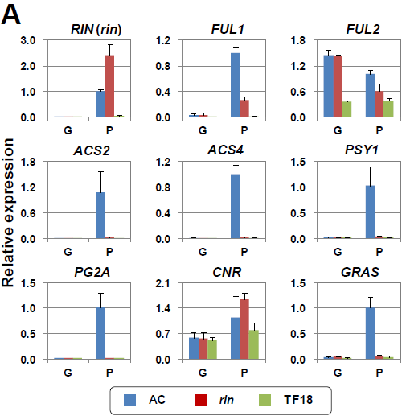
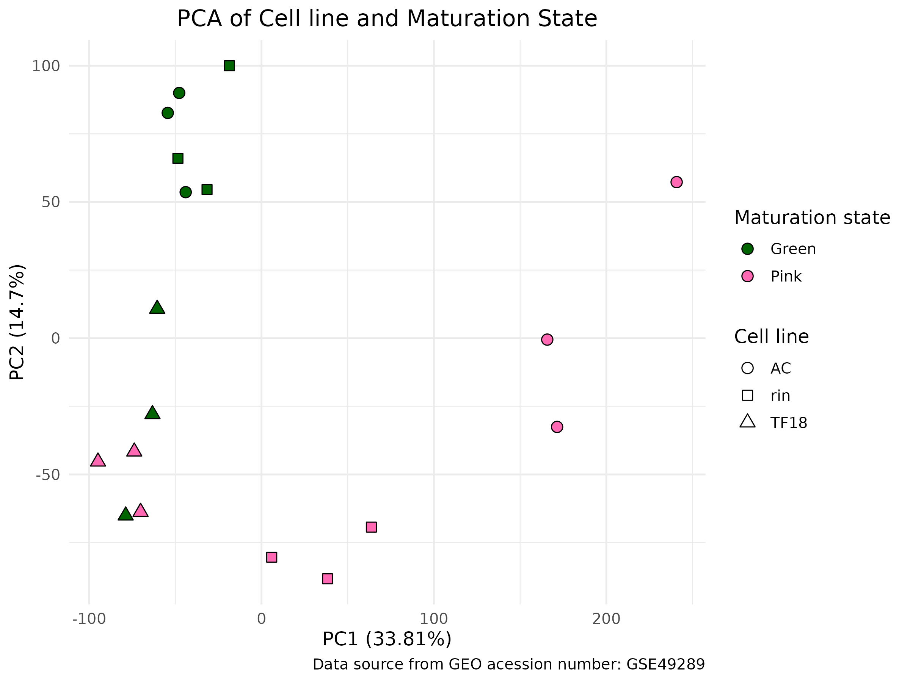

## Introduction to data

::: r-fit-text
- Article originally published in 2014 by Fujisawa *et al.*[^1]
- In the tomato: *Solanum lycopersicum*, what gene targets do the key ripening regulators: *FUL1* and *FUL2* have, and what effect do they have on fruit ripening?
- Three primary genotypes were examined: a wild type, a *FUL1*/*FUL2* repressed and one where the primary ripening inhibitor gene, *rin*, was mutated.
- Transcriptome profiling, functional classification and *in vitro* assays
:::

[^1]: Transcriptional Regulation of Fruit Ripening by Tomato FRUITFULL Homologs and Associated MADS Box Proteins, *The Plant Cell*, Volume 26, Issue 1, January 2014, Pages 89–101, <https://doi.org/10.1105/tpc.113.119453>

![Visualisation of tomato ripening. By Freschi *et al.*[^2]](presentation_files/Tomato_ripening.jpg){width="50%"}

[^2]: Fruit Physiology through Signaling Processes: Latest Advances and Future Challenges. *Int. J. Mol. Sci.* 2023,24, 976. [https://doi.org/10.3390/ijms24020976](https://doi.org/10.3390/ijms24020976Received:)

[^3]: Fruit Physiology through Signaling Processes: Latest Advances and Future Challenges. *Int. J. Mol. Sci.* 2023,24, 976. [https://doi.org/10.3390/ijms24020976](https://doi.org/10.3390/ijms24020976Received:)

## Project aim {.smaller}

**Hypothesis:** FUL1/FUL2 are required for normal ripening-associated gene expression, and their suppression will limit the transcriptional changes from the green to the pink stage in a pattern distinct from that of the *rin* mutation.

 
 
To test this, we recreate and analyse transcriptome profiling figures from the article and its supplement:

## Figures to recreate

::: r-fit-text
-   **Heatmap:** Compares fold changes of selected ripening genes between genotypes and stages
-   **Dendrogram:** Groups genes with similar expression patterns across the comparisons
-   **PCA** (instead of the article's MDS): Shows how similar the samples are based on overall expression
-   **Expression bar plots:** Compare the expression of individual genes across genotypes and stages
-   **qRT-PCR vs. RNA-seq scatter plot:** Checks how well the two methods agree
:::

::: {layout-ncol="4" layout-valign="bottom"}
{width="60%"}

{width="100%"}

{width="90%"}

{width="100%"}
:::

## Materials: Data from article

{fig-align="center" height="500"}

## Methods of data modelling {.smaller}

- Data wrangled into tidy format for analysis with tidyverse

{fig-align="center" height="430"}

## Figure 1 - Expression patterns {.smaller}

::::: columns
::: {.column width="45%"}
- The heatmap shows which genes are up- and downregulated

- The dendrogram groups genes with similar expression patterns

- More information...
:::

::: {.column width="55%"}
{fig-align="center" height="580"}
:::
:::::

## Figure 2 - Expression and validation

::: r-fit-text
- Several ripening genes, e.g. *ACS2* and *PSY1*, are induced in pink AC but barely expressed in *rin* and TF18
- qRT-PCR and RNA-seq measurements of selected genes agree well (R² = 0.94), supporting the reliability of the RNA-seq data
:::

::::: columns
::: {.column width="50%"}
{width="70%"}
:::

::: {.column width="50%"}
{width="70%"}
:::
:::::

## Figure 3 - PCA Analysis {.smaller}

::::: columns
::: {.column width="60%"}
{width="100%"}
:::

::: {.column width="40%"}
- AC changes clearly from green to pink (35 to 45 days after pollination)
- *rin* differs from AC but still changes between stages
- TF18 changes little, suggesting normal ripening-associated expression depends on FUL1/FUL2
- Green TF18 differs from green AC and *rin*: an effect already before ripening
- Limitation: PC1 and PC2 show only \~half of the variance
:::
:::::

## Discussion

::: r-fit-text
**FUL1/FUL2 suppression limits ripening-associated expression**

-   Many genes induced in the wild type are induced less in TF18 (heatmap)
-   Little separation between TF18 stages (PCA)
-   In pink fruit (45 days after pollination), many ripening-related genes are more reduced in TF18 than in *rin*

**Validation & Limitation**
-   RNA-seq validated against qRT-PCR for selected genes
-   Transcriptome analysis only: no direct data on phenotypic changes (e.g. metabolites)
-   Summarised data (replicate means) used where individual replicates were found too late; individual replicates used for PCA

 

**Conclusion**
Our analysis supports the hypothesis that FUL1/FUL2 are important for ripening-associated gene expression. Their suppression largely limits the changes seen in wild-type fruit, in a pattern distinct from, and for many selected genes stronger than, that of the *rin* mutation.
:::
