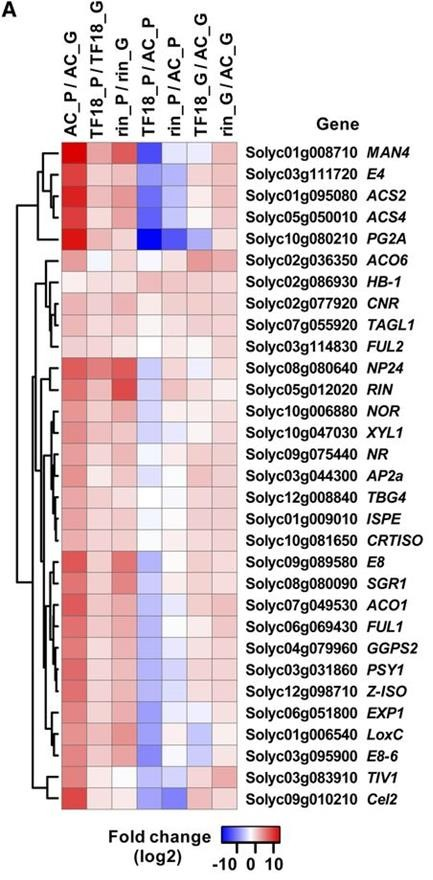
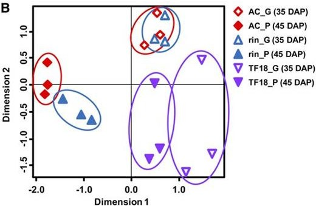
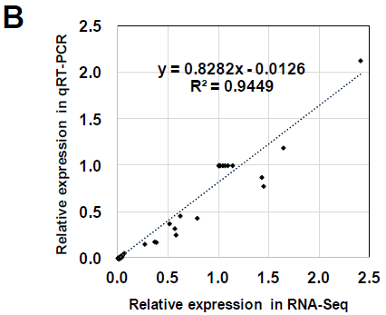
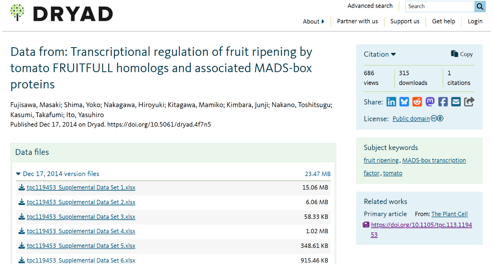
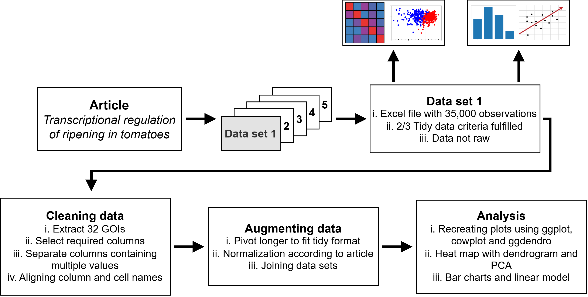
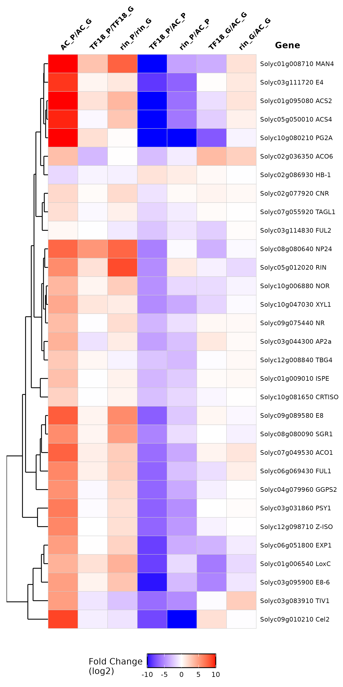
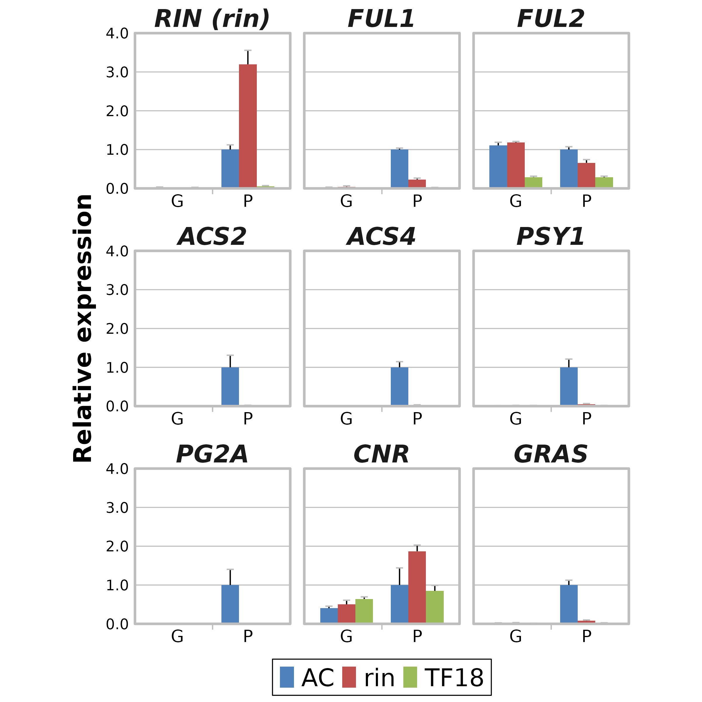

## Introduction to data

::: r-fit-text
-   Article originally published in 2014 by Fujisawa *et al.*[^1]
-   In the tomato: *Solanum lycopersicum*, what gene targets do the key ripening regulators: *FUL1* and *FUL2* have, and what effect do they have on fruit ripening?
-   Three primary genotypes were examined: a wild type, a *FUL1*/*FUL2* repressed and one where the primary ripening inhibitor gene, *rin*, was mutated.
-   Transcriptome profiling, functional classification and *in vitro* assays
:::

[^1]: Transcriptional Regulation of Fruit Ripening by Tomato FRUITFULL Homologs and Associated MADS Box Proteins, *The Plant Cell*, Volume 26, Issue 1, January 2014, Pages 89–101, <https://doi.org/10.1105/tpc.113.119453>

![Visualisation of tomato ripening. By Freschi *et al.*[^2]](presentation_files/Tomato_ripening.jpg){width="50%"}

[^2]: Fruit Physiology through Signaling Processes: Latest Advances and Future Challenges. *Int. J. Mol. Sci.* 2023,24, 976. [https://doi.org/10.3390/ijms24020976](https://doi.org/10.3390/ijms24020976Received:)

[^3]: Fruit Physiology through Signaling Processes: Latest Advances and Future Challenges. *Int. J. Mol. Sci.* 2023,24, 976. [https://doi.org/10.3390/ijms24020976](https://doi.org/10.3390/ijms24020976Received:)

## Project aim

::: r-fit-text
-   Wrangle data to fit into the tidy data format, to allow data analysis using tidyverse.
-   Recreate the two figures of the article as well as supplementary material, that visualize results of the transcriptome profiling analysis.


::: {.fragment}

::: {layout="[20, 25, 25, 25]"}






:::

:::

```{=html}
<!--# ### Objectives

1.  **Identify gene expression patterns**:\
    Understand the

2.  **What do we need Figure 2 for??**:\
    Investigate the

3.  **PCA plot**:\
    Determine the grouping of samples and the ripening stages -->
```
:::

## Materials: Data from article

{width="70%"}

## Methods of data modelling

Methods: Which modelling did you use? Think of the methods section as a recipe for how to go from raw to results

{width="80%"}

Data wrangling

Analysises used Heatmap PCA

## Figure 1 - visualization of the expression patterns

::::: columns
::: {.column width="50%"}
-   Heatmap illustrate expression patterns, which genes are up- and down regulated.

-   Dendogram identify which genes have similar expression patterns
:::

::: {.column width="50%"}
{width="40%"}
:::
:::::

## Figure 2

Short text about the figures

::::: columns
::: {.column width="50%"}
{width="100%"}
:::

::: {.column width="50%"}
{width="100%"}
:::
:::::

## Figure 3 - PCA Analysis

{width="100%"}

## Discussion
